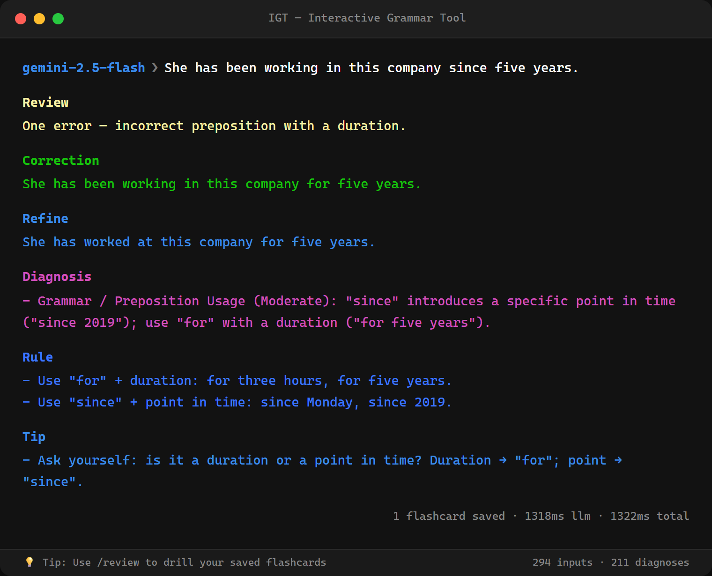
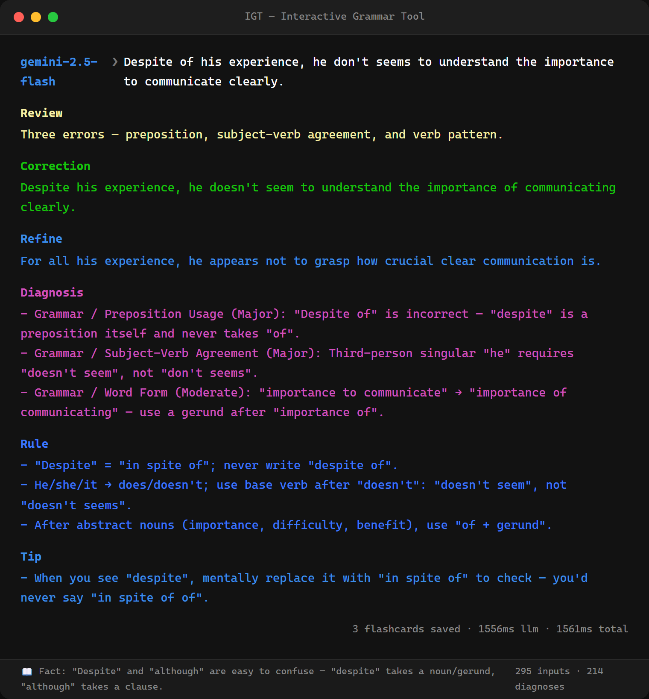
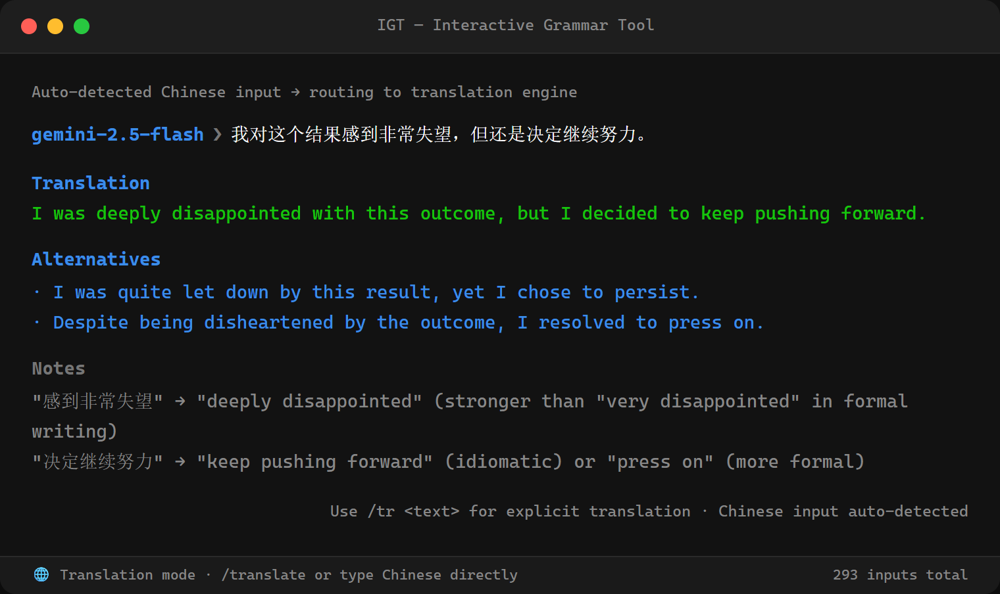
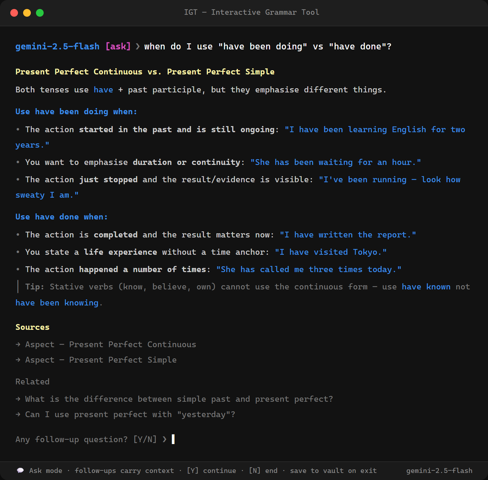
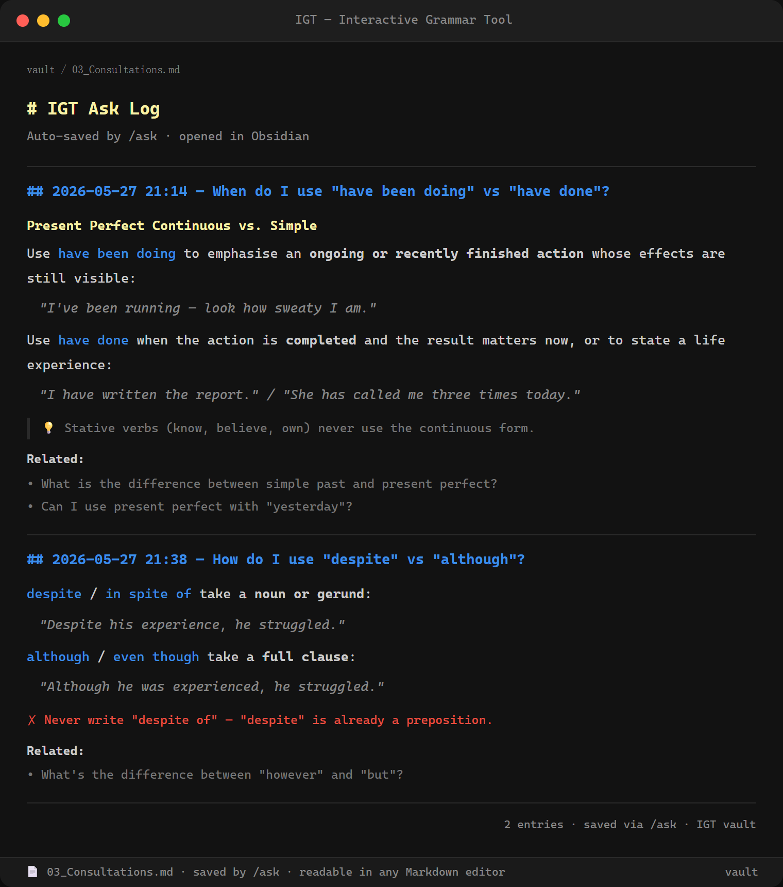
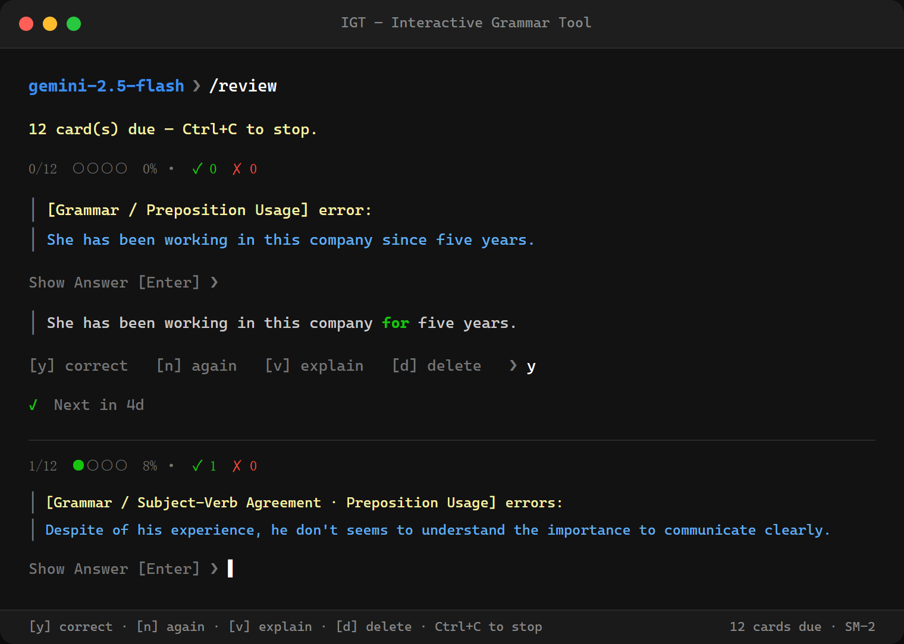
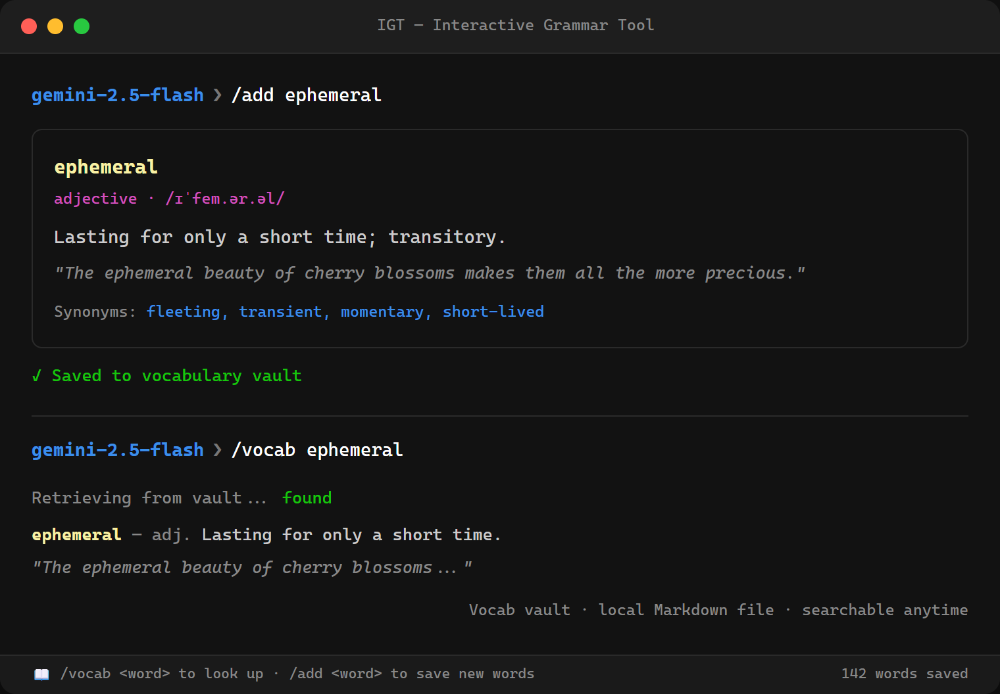

# IGT — Your English, clearer.

IGT is a personal English-learning workspace for clearer communication at work and in everyday life. Its local Web app brings grammar feedback, **Express** coaching, vocabulary, sentence Practice, Ask, Handbook, and Coach together in one place. Your learning data stays on your device in a local database and Markdown files.

Prefer the terminal? IGT also includes a command-line companion for writing feedback, translation, conversation, listening, and review.


---

## Table of Contents

- [IGT Web](#igt-web)
- [A Connected Learning Routine](#a-connected-learning-routine)
- [Before You Start](#before-you-start)
- [Installation (Step by Step)](#installation-step-by-step)
- [Database Initialization & Migrations](#database-initialization--migrations)
- [Setting Up Your AI Provider](#setting-up-your-ai-provider)
  - [Option A — Online AI (Gemini, Qwen, Deepseek)](#option-a--online-ai-gemini-qwen-deepseek)
  - [Option B — Local AI with Ollama (No API Key)](#option-b--local-ai-with-ollama-no-api-key)
- [Features](#features)
- [Local Web](#local-web)
- [Commands](#commands)
- [Configuration Reference](#configuration-reference)
- [Architecture](#architecture)
- [License](#license)

---

## IGT Web

**Your English, clearer.** IGT Web is the visual home for your English-learning routine. Move between focused workspaces for Grammar, Express, Vocabulary, Review, sentence Practice, Ask, Handbook, and Coach. Use **Express** to shape what you want to say or understand, with natural English and helpful language notes rather than word-for-word translation.

The Web app runs locally and connects to IGT's Local Runtime. It uses your configured AI provider and local learning data; it is not a hosted account or cloud service. Start with the [Local Web setup](#local-web) after installing dependencies.

The terminal workflow remains available with `igt` or `node igt.mjs` for learners who prefer commands.

---

## A connected learning routine

In the CLI, use `/help` to browse commands by learning activity, or `/today` to see your review counts and choose a short session.

1. **Learn an expression:** `/word follow up`. Read its meaning, collocations, and examples; choose whether to save it.
2. **Listen and repeat:** `/listen` plays the latest English expression and, after a vocabulary lookup, its first available example. Repeat aloud, then make your own sentence. Use `/listen <English text>` for a specific phrase and `/listen --stop` to stop playback.
3. **Use it:** type a daily update or work message, such as “I will follow up with the client tomorrow.” Use `/explain` to understand any correction, or translate a Chinese expression and replay the English.
4. **Converse:** open `/chat` and describe a situation: “Help me practise asking a colleague for clarification.” Inside chat, `/voice on`, `/voice off`, `/voice status`, `/listen`, and `/exit` are local controls.
5. **Recall it later:** `/word 5` reviews vocabulary. Use `/practice` for Chinese-to-English sentence translation.

`/listen` also remembers the latest correction, the English side of a translation, quiz feedback, a chat reply, or a revealed review answer. It works on demand even when automatic chat voice is off. Playback uses your existing TTS configuration. Listening and repeating are self-practice; IGT does not record or assess pronunciation.

## Before You Start

You need two things installed on your computer before you can run IGT.

### 1. Node.js

Node.js is a program that runs JavaScript code outside a web browser. IGT is built with it.

- Go to **https://nodejs.org** and download the **LTS** version (the left button).

- Run the installer and accept the defaults.

- When finished, open a terminal (Command Prompt or PowerShell on Windows, Terminal on Mac/Linux) and verify it worked:
  
  ```
  node --version
  ```
  
  You should see something like `v22.0.0`. Any version 18 or higher is fine.

### 2. Git

Git is a tool for downloading and managing code from the internet.

- Go to **https://git-scm.com/downloads** and download the installer for your system.

- Run it with the default settings.

- Verify:
  
  ```
  git --version
  ```
  
  You should see something like `git version 2.44.0`.

---

## Installation (Step by Step)

Open a terminal and follow these steps exactly, one at a time.

**Step 1 — Download the code**

```sh
git clone https://github.com/ievertan00/igt.git
```

This creates a folder called `igt` in your current directory.

**Step 2 — Enter the folder**

```sh
cd igt
```

**Step 3 — Install dependencies**

```sh
npm install
```

This downloads the libraries IGT needs (into a `node_modules` folder). It may take a minute.

**Step 4 — Create your configuration file**

```sh
# On Windows (PowerShell):
Copy-Item .env.example .env

# On Mac/Linux:
cp .env.example .env
```

This creates your private `.env` file where you will add your API key.

**Step 5 — Add your API key**

Open the `.env` file in any text editor (Notepad, VS Code, etc.) and fill in at least one API key. See [Setting Up Your AI Provider](#setting-up-your-ai-provider) for where to get keys.

**Step 6 — Set up the database**

```sh
node scripts/init-db.mjs
```

This creates the local SQLite database that stores your grammar history, flashcards, and progress.

**Step 7 — Register the global command (optional but recommended)**

```sh
npm link
```

After this, you can type `igt` from any folder in any terminal to launch the tool. You only need to run this once.

**Step 8 — Launch IGT**

```sh
igt
```

Or, if you skipped Step 7:

```sh
node igt.mjs
```

You should see a prompt like `gemini-2.5-flash ❯`. Start typing a sentence.

---

## Database Initialization & Migrations

IGT uses a local SQLite database (`igt_data.db`) to store your learning progress. The database is managed through a migration system to ensure it stays up-to-date as new features are added.

### First-Time Setup

On your very first run, you MUST initialize the database:

```sh
node scripts/init-db.mjs
```

This will:

1. Create the database file if it doesn't exist.
2. Apply the core schema (tables for sessions, inputs, diagnoses, etc.).
3. Seed the initial status messages (Tips, Facts, Quotes).

### Automatic Updates

Every time you launch IGT, the server automatically checks for any missing migrations and applies them. You generally don't need to run `init-db.mjs` again unless you are troubleshooting or have manually deleted your database file.

### Troubleshooting

- **"Database is locked"**: This usually happens if multiple instances of IGT are running or if another tool is accessing the `.db` file. Close all instances and try again.
- **Migration errors**: If a migration fails, IGT will log the error to `igt_db_error.log`. You can safely delete the `.db` file and run `node scripts/init-db.mjs` to start fresh (note: this will erase your history).

---

## Setting Up Your AI Provider

IGT can use either online AI services (which require a free API key) or a local AI model running on your own computer (no key needed).

---

### Option A — Online AI (Gemini, Qwen, Deepseek)

All three services offer free tiers. Pick one to start.

#### Google Gemini (recommended for beginners — most generous free tier)

1. Go to **https://aistudio.google.com/apikey** and sign in with a Google account.

2. Click **Create API key**.

3. Copy the key (it starts with `AIza…`).

4. Open your `.env` file and paste it:
   
   ```env
   GOOGLE_API_KEYS=AIzaSyYourKeyHere
   IGT_LLM_PROVIDER=gemini
   ```

5. Save the file. Launch `igt`.

> You can add multiple Gemini keys separated by commas (`key1,key2`) — IGT rotates through them automatically if one hits its rate limit.

---

#### Alibaba Qwen (DashScope)

1. Go to **https://dashscope.console.aliyun.com/apiKey** and create an account.

2. Create an API key and copy it.

3. Open `.env` and paste it:
   
   ```env
   DASHSCOPE_API_KEYS=sk-YourKeyHere
   IGT_LLM_PROVIDER=qwen
   ```

4. Save and launch `igt`.

---

#### Deepseek

1. Go to **https://platform.deepseek.com/api_keys** and create an account.

2. Create an API key and copy it.

3. Open `.env` and paste it:
   
   ```env
   DEEPSEEK_API_KEYS=sk-YourKeyHere
   IGT_LLM_PROVIDER=deepseek
   ```

4. Save and launch `igt`.

---

#### Switching providers while running

You can switch without restarting. At the `❯` prompt:

```
/gemini      → switch to Gemini
/qwen        → switch to Qwen
/deepseek    → switch to Deepseek
/ollama      → switch to local Ollama
/llm status  → show which provider is active and which keys are configured
```

---

### Option B — Local AI with Ollama (No API Key)

Ollama runs an AI model entirely on your computer. No internet connection is needed for grammar checks, and there are no usage limits or fees. The tradeoff is that it requires a reasonably modern computer and takes a few minutes to set up.

**System requirements:** 8 GB RAM minimum; 16 GB recommended for good quality. A dedicated GPU speeds things up significantly but is not required.

#### Step 1 — Install Ollama

Go to **https://ollama.com/download** and install it for your system. On Windows, run the `.exe` installer. On Mac, drag the app to Applications. On Linux, run the shell script shown on the site.

Verify it's installed:

```sh
ollama --version
```

#### Step 2 — Download a model

IGT currently uses the configured **Gemma** local model family. Pull the model named in `igt_config.json` (the default is `gemma4:12b`):

```sh
ollama pull gemma4:12b
```

The download is several GB and only needs to happen once. To point Ollama at a different local model, edit its `Ollama*Model` field in `igt_config.json` (run `ollama list` to see what you have installed).

#### Step 3 — Configure IGT to use Ollama

Open your `.env` file and set:

```env
IGT_LLM_PROVIDER=ollama
```

No API key is needed for Ollama.

#### Step 4 — Start Ollama and launch IGT

Ollama usually starts automatically at login. If it isn't running, start it:

```sh
ollama serve
```

Then in a new terminal window:

```sh
igt
```

The prompt will show the active model (e.g. `gemma4:12b ❯`). The first request may take 10–20 seconds while the model loads into memory; subsequent requests are faster.

---

## Features

### Grammar Checking

Type any English sentence at the prompt and press Enter. IGT sends it to the AI and returns a structured analysis — correction, a more natural rewrite, diagnosis by error type, rule, and tip. Complex sentences with multiple errors are handled in a single pass, each diagnosed separately.





If your sentence has no errors, IGT confirms it and explains why it's correct — it won't invent problems.

Every check is saved to your local database and automatically generates a flashcard.

### Translation (`/translate` or auto-detect)

Translate Chinese text to English naturally. IGT automatically detects Chinese input at the main prompt and routes it to the translation engine, complete with nuance notes and idioms. Or, use `/translate <text>` (alias: `/tr <text>`).



### Grammar Consultation (`/ask`)

Ask multi-turn questions about English grammar. IGT queries its local reference database (`grammar_ref.db`) via native function-calling to provide grounded, reliable answers with source citations. Follow-ups in the same thread carry context.



When you finish a CLI thread, IGT prompts you to save. A single answer is preserved; a multi-turn thread is summarized into one standalone Markdown note in the configured Ask directory. The Web Ask page can save an individual answer or summarize and save the conversation.

AI generates a descriptive **Simplified Chinese title**, topic tags, and a category in the existing answer or conversation-summary request, regardless of the question's language. Both CLI and Web save new notes as `<中文标题>.md`, retaining English terms when they identify the topic and omitting English subtitle translations. Titles are limited to 50 characters and cleaned for filesystem and Markdown-link compatibility; different notes with the same title receive a numeric suffix instead of overwriting each other. If an older response has no Chinese title, saving makes one title-only AI request to generate it. If that fails, the conversation remains available for retry and no English-named fallback note is written.

Saving writes metadata as YAML frontmatter, readable in Obsidian and other Markdown tools. The CLI shows the saved metadata; Web **Saved notes** displays titles and supports text search, category and tag filters, and clickable topics. Categories cover Grammar, Vocabulary, Pronunciation, Writing, Reading, Listening, Conversation, and Other. Older notes remain readable as Uncategorized; incomplete tags or categories do not block saving and are reported in the save confirmation. Retrying the same conversation reuses the existing note and its metadata.



### Conversation Practice (`/chat`)

Practice English by just talking. `/chat` opens a free-flowing conversation partner that chats naturally about whatever you bring up and keeps the exchange going with follow-up questions — it won't turn every reply into a lecture. After each of your messages it quietly checks *only* what you wrote for genuine mistakes and lists gentle corrections (original → natural version → a short friendly note), leaving your conversation uninterrupted.

Optionally, replies can be spoken aloud. Toggle voice on/off with `/voice`. Spoken output needs a local text-to-speech server — see the TTS notes under [Configuration Reference](#configuration-reference).

### Explain a Correction (`/explain`)

Just got a correction you don't fully understand? Run `/explain` (alias `/e`) and IGT opens an `/ask` thread pre-loaded with your last sentence, its correction, and the diagnosed errors — so you can dig into *why* without retyping anything. Add a specific question (`/explain why is "the" wrong here?`) or run it bare for a general walkthrough.

### Status Bar & Tips

After every check, the status bar displays a random message from a collection of 300+ items, including:

- **Tips**: Learn hidden features like `/undo` or `/refine`.
- **Grammar Facts**: Interesting trivia about English history and rules.
- **Quotes**: Inspiring words from linguists and authors.

### Multiline Input

For paragraphs or longer passages, enter multiline mode with `"""`:

```
❯ """
Type your text here.
Press """ on a new line to submit.
"""
```

### Vocabulary SRS Review (`/word review`)

On the Web, **Vocabulary → Saved words** opens the complete Markdown vocabulary library, including entries that are not due or have been removed from SRS review. Search words, Chinese/English meanings, examples and notes; sort alphabetically or by saved date; open any word in a separate detail dialog for pronunciation, all saved examples, collocations and notes. Browsing this page does not change review schedules.

For an API/UI-only restart that must preserve a reduced SRS deck, use `node scripts/web-dev.mjs --skip-vocabulary-sync` (or `node apps/local/server.mjs --skip-vocabulary-sync`). Normal startup and starting a new Web review session still import saved vocabulary into SRS.

CLI `/word review` and Web **Vocabulary review** use the same vocabulary queue and four-rating SRS scheduler. Type the English expression, check the answer, then choose **Again / Hard / Good / Easy**. Checking only reveals feedback; selecting a rating saves one review and its next date. In the CLI, use `1–4` or the rating name to save and continue. On the Web, select a rating, then use **Next word** (Enter also advances after saving).

| Rating | 本次回忆感受 | New card / after Again | Established card |
|---|---|---|---|
| Again | 没有记住，需要尽快复习。 | Today; repeat at the end of this session | Today; reset the learning interval |
| Hard | 回忆困难。 | 1 day | At least previous interval + 1 day, or 1.2× previous interval |
| Good | 正常回忆成功。 | 3 days | Previous interval × ease, at least Hard + 1 day |
| Easy | 轻松掌握。 | 7 days | Previous interval × ease × 1.3, at least Good + 1 day |

Intervals are rounded to whole days. Ease starts at 2.5, has a 1.3 floor, and changes by −0.20 / −0.15 / 0 / +0.15 for Again / Hard / Good / Easy. Again resets the successful-rating streak; the next successful rating returns to the learning intervals. Due dates follow Asia/Shanghai. Existing cards keep their current schedules until reviewed; there is no bulk reset or vocabulary-file rewrite.

Spelling checks ignore case, spaces, and hyphens; blank submissions are incorrect. Typed correctness and the selected recall rating are recorded separately: Easy describes this attempt, not durable mastery. Audio use is retained with the review evidence. Saves are atomic and retryable with the same answer, rating, and request ID so a lost response does not double-count a review.



### Daily Plan (`/today`)

Shows today’s checked sentences, words added, and grammar/vocabulary cards reviewed—even on a vocabulary-only day. It lists exact due counts for both decks and suggests listening, writing, and conversation activities for everyday life and work.

When cards are due, choose `g` for five grammar cards, `w` for five vocabulary cards, or Enter to continue later. Review counts cover cards already in SQLite; `/word` also imports saved vocabulary notes.

`/today` retains review entry points; it no longer creates Coach plans or displays plan tasks.

### Learning Overview (`/stats`)

Web Overview and `/stats` summarize saved activity by type and show a recent-activity timeline. Grammar checks, sentence Practice, vocabulary review attempts, saved words, and Ask notes keep separate counts. Activity volume is not a mastery score. Unsaved translation, listening, and conversation interactions have no durable history; unavailable sources and undated records are disclosed.

```text
/stats --days 30 --limit 10
/stats --days 0 --offset 10
```

### Grammar Check History (`/handbook`)

Handbook lists explicitly saved Grammar checks, newest first, preserving the original text, correction, explanations, and date. Search and filter by mistake type, date window, or no diagnosed mistakes. Each check appears once even if it contains several diagnoses. A check with no diagnoses does not establish mastery or error-free writing. Legacy records with unknown origins remain intact and are excluded from Grammar-only views.

```text
/handbook
/handbook --search "a book" --days 0
/handbook --type "Articles" --limit 10 --offset 0
/handbook --diagnosis none
```

### Recurring Mistakes (`/coach`)

Coach analyzes saved Grammar checks only. A recurring pattern requires at least two distinct checks. The default command lists patterns without a model call; requesting a pattern generates possible causes, the grammar principle, contextual qualifications, and examples linked to their saved records. Causes are hypotheses, not confirmed psychological explanations or assessments of overall English ability.

```text
/coach --days 90
/coach --type "Articles" --days 90
/coach --type "Articles" --refresh
```

These commands replace Handbook report generation/cache management and Coach plan/task management. The `/plan` alias is removed. Existing reports, plans, and learning records are preserved. Use `--help` for all supported options.

### Sentence Translation Practice (`/practice`)

Translate a Chinese sentence into English, then receive LLM feedback on meaning, grammar, naturalness, and tone. Practice contains sentence translation only.

The active bank contains 303 authored questions across 101 language focuses, seeded into SQLite on startup by migration 022 (after migration 021 creates the bank). Every focus has clear-cue, contrast, and transfer variants. Starting a session does not call the LLM or require grammar history. Categories:

- Difficulty: `easy`, `standard`, `challenge`.
- Style: `casual`, `neutral`, `formal` (or `all`).
- Context: `everyday`, `work`, `travel` (or `all`).

`/practice` defaults to three standard questions across all styles and contexts. `/practice sentence` and `/ps` open the same workflow.

```text
/practice 5 --difficulty easy
/practice sentence 3 --style formal --context work
```

Web Practice provides the same category filters and a 3 / 5 / 10 question selector. Questions are distinct within a session; less-used questions are selected first, with repeats allowed as the bank is covered. Category sizes vary; larger requests return the available set with a notice, and empty categories invite another selection.

Each question has three optional hints: a meaning cue, a construction cue, and a complete language pattern with unfilled slots. Web reveals them one at a time; type `h` in CLI Practice to reveal the next hint. Hints contain no finished translation or context narrative. References appear after evaluation, and valid alternative translations remain acceptable even when they use another construction. Attempts record hint usage and language categories alongside feedback; assisted success is not evidence of independent mastery.

The bank includes communicative purpose, meaning relationship, register, tone, five situations, and six genres. The existing three context filters group daily life, social relationships, and services under `everyday`; finer situation labels remain in question metadata. Focus-level defaults and question difficulty are separate: transfer or subtle contrasts can change a question's band.

The authored set is maintained in `lib/features/practice/language-seeds.mjs`, with focus definitions in `language-focuses.json`. Migration 023 removes the 81 original question rows by their exact seed IDs, leaving the new bank, custom questions, and recorded attempts intact. Sessions referring to removed questions must be restarted. Migration replay preserves usage counts and custom questions. Existing learner records and vocabulary review remain available.

### Vocabulary Lookup (`/word`)

Look up any word and save it to your local Markdown vocabulary vault. Review saved words with `/word review`.



### Undo (`/undo`)

Made a typo and don't want it in your flashcard deck? Undo your last input:

```
❯ /undo
Delete last 1 input and all associated cards? [y/n] y
✓ Removed.
```

Use `/undo 3` to remove the last 3 inputs.

---

## Local Web

IGT Web is the visual learning workspace branded **IGT · Your English, clearer.** Its navigation includes Grammar, Express, Vocabulary, Review, Practice, Ask, Handbook, and Coach. The app runs independently from the CLI REPL and uses the same local SQLite database, Markdown learning files, and configured LLM through the Local Runtime.

```powershell
npm install
npm run web:dev       # Vite + Local Runtime; defaults to 5173 and 18964
npm run web:start     # production Web from apps/web/dist
```

For a production start, build first with `npm run web:build`. Set `IGT_DEV_API_PORT` and `IGT_WEB_PORT` in `.env` when the development ports are occupied. The Runtime binds to `127.0.0.1` by default; `IGT_SERVER_PORT=0` selects an available production port.

Useful acceptance checks:

```powershell
npm run web:typecheck
npm run test:web-dev
npm run test:runtime
npm run test:static
npm run test:web
npm run test:coach-cache
npm run test:vocabulary-sync
npm run test:review-log-contract
npm run test:config-paths
npm run test:migration-backup
```

The Local Runtime synchronizes Vocabulary Markdown into rebuildable SQLite SRS
cards at startup. Markdown remains the content authority; review scheduling
fields are preserved during synchronization.

## Commands

Start IGT with `igt`. All commands use a `/` prefix. Most have a short alias (shown in parentheses).

| Command            | Description                                                       |
| ------------------ | ----------------------------------------------------------------- |
| `/word review`     | SRS review session — drills vocabulary cards due today            |
| `/word` (`/w`, `/a`) | Vocabulary lookup, saving, and SRS review; `/word --list` to browse |
| `/practice sentence` | Sentence production practice                                  |
| `/today` | Grammar and vocabulary review counts, listening, writing, and conversation |
| `/stats` (`/st`) | Recorded learning activity summary and timeline |
| `/handbook` (`/h`) | Browse, search and filter saved Grammar checks |
| `/coach` | Recurring Grammar mistakes with explanations on demand |
| `/practice` (`/p`) | Unified word, sentence, and choice practice entry point          |
| `/ask`             | Open a multi-turn grammar consultation thread (opt-in save)       |
| `/chat`            | Free-conversation practice with gentle corrections (optional voice) |
| `/explain` (`/e`)  | Explain your last grammar correction in an `/ask` thread          |
| `/translate` (`/tr`) | Translate between Chinese and English (auto-detects direction)  |
| `/text`            | Open an editor and analyze a complete text document               |
| `/retry`           | Re-run your last input with the same model                        |
| `/undo [N]` (`/u`) | Delete the last N inputs and their flashcards (default: 1)        |
| `/voice [on\|off\|status]` | Control automatic chat speech, including inside `/chat` |
| `/listen [text]` | Replay the latest English expression or supplied text; `--stop` stops audio |
| `/gemini`          | Switch to Google Gemini                                           |
| `/qwen`            | Switch to Alibaba Qwen                                            |
| `/deepseek`        | Switch to Deepseek                                                |
| `/ollama`          | Switch to the default local Ollama model                         |
| `/gemma`           | Switch to local Gemma 4 (Ollama)                                 |
| `/llm status`      | Show active provider, configured keys, and model names            |
| `/theme`           | Switch the UI color theme                                         |
| `/help`            | Show command reference                                            |
| `/exit` (`/q`)     | Quit (shows session summary first)                                |

**Keyboard shortcuts:**

- `↑` / `↓` — browse input history
- `Ctrl+C` — clear current input and return to prompt (does not exit)
- `"""` — enter multiline input mode

---

## Configuration Reference

IGT uses two configuration files:

| File              | Tracked by git | Purpose                                |
| ----------------- | -------------- | -------------------------------------- |
| `.env`            | No             | API keys, file paths, themes (private) |
| `igt_config.json` | Yes            | Model names, prompts (shared)          |

### `.env` (common settings)

The shipped `.env.example` is a fully annotated template — copy it and fill in what you need. The most common settings:

```env
# --- AI Provider Keys ---
GOOGLE_API_KEYS=key1,key2        # comma-separated; IGT rotates on rate-limit
DASHSCOPE_API_KEYS=your-key      # Qwen / Alibaba DashScope
DEEPSEEK_API_KEYS=your-key       # Deepseek
IGT_LLM_PROVIDER=gemini          # gemini | qwen | deepseek | ollama

# --- Model overrides (optional; override igt_config.json per provider) ---
IGT_GEMINI_FLASH_MODEL=          # e.g. gemini-2.5-flash
IGT_QWEN_PRO_MODEL=              # e.g. qwen-plus, qwen-max
IGT_OLLAMA_FLASH_MODEL=          # e.g. phi4, gemma4:12b

# --- File Paths & Settings ---
IGT_DB_PATH=igt_data.db          # SQLite database (auto-created on first run)
IGT_LOG_PATH=igt_db_error.log    # background error log
IGT_GRAMMAR_REF_DB_PATH=grammar_ref.db # Grammar reference database for /ask
IGT_THEME=auto                   # auto | light | dark; changes semantic colors only
IGT_REVIEW_PATH=                 # optional: path to a Markdown corrections log
IGT_REPORT_PATH=                 # folder for handbook exports

# --- Obsidian Integration (optional) ---
IGT_VAULT_DIR=                   # root of your Obsidian vault
IGT_VOCABULARY_FILE=             # vocabulary note path within vault
IGT_PRACTICE_FILE=               # practice log path within vault
IGT_ASK_FILE=                    # /ask consultation log (single file) within vault
IGT_ASK_DIR=                     # /ask separate-notes directory within vault

# --- Text-to-Speech (optional; /chat voice, /word review [a]) ---
IGT_TTS_BASE_URL=http://localhost:8880  # OpenAI-compatible /v1/audio/speech server
IGT_TTS_SIDECAR=                 # adapter script to auto-launch (blank = none)
IGT_TTS_STREAM=false             # low-latency ffplay streaming (needs ffmpeg)
IGT_TTS_VOICE=                   # optional; defaults to af_heart
IGT_TTS_MODEL=                   # optional; defaults to kokoro
```

> **Text-to-speech.** Spoken replies in `/chat` (and the `[a]` key in `/word review`) need a local TTS server speaking the OpenAI `/v1/audio/speech` protocol, reachable at `IGT_TTS_BASE_URL`. Two backends are supported:
>
> - **Kokoro** (default) — a native OpenAI-compatible server with preset voices ([Kokoro-FastAPI](https://github.com/remsky/Kokoro-FastAPI) on port `8880`). No adapter needed.
> - **CosyVoice3** — clones a reference voice (cross-lingual). It runs behind a small local shim (`tools/cosyvoice-tts-shim.mjs`, auto-launched via `IGT_TTS_SIDECAR`) that fronts a CosyVoice Docker container. See the CosyVoice profile in `.env.example` and `tools/cosyvoice/` for setup.
>
> Switch backends by swapping which profile is active in `.env`, then restart `igt`. If no server is reachable, IGT prints a one-time notice and stays silent — text output is unaffected. Toggle voice with `/voice`.

### `igt_config.json` (excerpt)

```json
{
  "LLMProvider": "gemini",
  "GeminiFlashModel": "gemini-2.5-flash",
  "GeminiProModel": "gemini-2.5-pro",
  "QwenFlashModel": "qwen-turbo",
  "QwenProModel": "qwen3.6-plus",
  "DeepseekFlashModel": "deepseek-v4-flash",
  "DeepseekProModel": "deepseek-v4-pro",
  "OllamaBaseUrl": "http://localhost:11434",
  "OllamaFamily": "gemma",
  "OllamaGemmaFlashModel": "gemma4:12b"
}
```

Flash models handle grammar correction (speed-optimized); Pro models handle handbook and practice generation (quality-optimized). Ollama uses the configured Gemma model family. To use a different local model, update the matching `Ollama*Model` field — run `ollama list` to see what you have installed.

All LLM prompts live in the `Prompts` section of `igt_config.json`. You can edit them to tune IGT's behavior without touching source files.

---

## Architecture

`igt.mjs` (interactive loop) can start the independent Local Web Runtime (`lib/server/index.mjs`) on an injected fixed or dynamic local port. Each grammar check is an HTTP POST to the runtime; the server returns structured JSON and the client owns rendering. `npm run web:start` uses the same runtime without starting the CLI REPL.

```
CLI / Web ──HTTP──►  Local Web Runtime
                         lib/server/index.mjs
                                    │
                          runMigrations() at boot
                          LLMProviderManager
                          ┌──────┬──────┬──────────┬────────┐
                       Gemini  Qwen  Deepseek  Ollama   ← flash model for grammar
                                                          pro model for handbook
                                    │
                          parseDiagnosis() → SQLite (non-blocking)
                                    │
                          {data, perf} ◄── igt.mjs renders with color
```

The codebase is organized into domain-driven modules under `lib/`:

- `lib/cli/` — CLI-specific logic, UI rendering, and command routing.
- `lib/domain/` — Core business logic (SRS, mastery, parsing).
- `lib/features/` — Feature-specific logic (e.g., handbook generation).
- `lib/server/` — HTTP server, routing, and LLM provider logic.
- `lib/shared/` — Shared utilities like configuration loaders.

The persistent server eliminates per-request Node.js startup overhead — typical grammar check time is ~1.5s vs ~9.9s with a cold-start approach (83% faster).

---

## License

Apache 2.0
