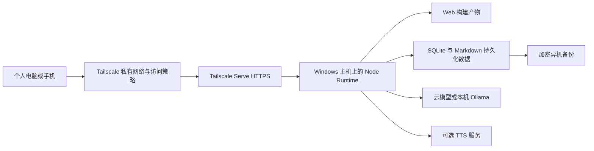

# ClearWrite Web 部署方案

编制日期：2026-11-16。范围：部署设计与上线清单；本次不修改应用、不启动新实例、不迁移实际数据。

## 1. 推荐决策

首版采用「单用户、单实例、持久化磁盘、受控远程访问」。保留现有 React/Vite + Node Runtime + SQLite + Markdown 架构。

默认假设：先满足自己在电脑和手机上的访问需求，暂不提供公众注册。若目标是多人独立使用，须先完成第 9 节的用户隔离，不能将当前实例直接作为多用户产品发布。

| 场景 | 部署方式 | 使用条件 |
| --- | --- | --- |
| 个人远程使用，保留 Ollama、Obsidian | 现有 Windows 主机 + Tailscale Serve | 推荐首版；主机须持续在线，访问设备加入私有网络 |
| 独立于个人电脑持续运行 | 专用服务器 + HTTPS 反向代理 + 身份网关 | 后续方案；迁移数据和模型依赖，完成目标系统适配验证 |
| 多人公开使用 | 独立 Web 服务 + 用户认证与数据隔离 | 产品改造后再部署 |

不将当前后端部署为短生命周期函数，也不只上传前端 dist：当前后端需要持久化文件、SQLite 和长耗时模型请求。

## 2. 已核实的项目条件

- `apps/local/server.mjs` 导入 `lib/server/index.mjs`，可独立于 CLI 运行。
- `npm run client:build` 构建至 `apps/web/dist`（桌面端）与 `apps/web/dist/mobile`（安卓端，挂 `/mobile/`）；Runtime 已提供静态文件、按前缀区分的 SPA 回退和 API。仅执行 `web:build` 会清空 `dist/`，导致 `/mobile/` 无产物。
- `lib/server/routes/runtime.mjs` 返回固定 `local-user`；HTTP 入口与路由器未提供统一登录校验。
- 存在修改模型配置、写入 `.env`、设置服务器文件路径和管理模型的接口；远程访问者获得的是服务器能力。
- 路由存在宽泛 CORS 配置，POST 正文解析未设置大小上限。
- SQLite 开启 WAL；Runtime 启动会执行迁移，并默认同步 Vocabulary Markdown 至 SRS。
- 数据位置由 `.env`、`igt_config.json` 和显式路径共同决定；不能假定设置 `IGT_DATA_DIR` 就覆盖所有历史配置。
- `package-lock.json` 当前未被 Git 跟踪，且被 `.gitignore` 忽略；尚无检出的 Docker 或部署配置文件。
- 当前工作区含多项未提交改动和新迁移；发布内容须来自明确、可追踪的版本。

以上以当前源码为准，历史 graphify 索引仅用于定位。

## 3. 首版拓扑



Node 仅监听本机回环地址，固定端口由 `.env` 提供。Tailscale Serve 代理整个站点，访问策略仅允许指定用户和设备。不得改用公开 Funnel 来绕过这层访问控制。

公网域名方案则使用「浏览器 → HTTPS 反向代理 → 身份网关 → 本机 Node」，保护页面和所有 API，不能只保护首页。Caddy 可承担 HTTPS 和反向代理，身份认证需另行配置。

网页和 API 保持同源；现有接口使用 `/grammar`、`/practice`、`/settings` 等路径，首版代理整个站点，避免仅转发 `/api`。

## 4. 上线前应用与运行配置

### P0：首版必须完成

1. 固定发布版本；保留无关工作区改动，在独立发布目录安装和构建。
2. 将审核后的 `package-lock.json` 纳入版本控制；目标主机用 `npm ci` 安装。固定已验证的 Node 24 补丁版本；`better-sqlite3` 在目标平台安装，不能复制 Windows 的 `node_modules` 到其他平台。
3. 显式加载 `.env`。当前 `web:start` 未使用 `--env-file`，而监听地址、端口直接读取 `process.env`；仅在 `.env` 填值不足以保证监听配置生效。建议后续将启动脚本统一为 `node --env-file=.env apps/local/server.mjs`。
4. 使用专用、低权限服务账号运行；可写范围限制到配置、数据和日志目录。当前设置页面会写 `.env`，不能直接将该文件改为只读而保留原交互。
5. 在 Windows 服务管理器或任务计划中配置开机启动、故障重启、明确工作目录和日志轮转；不依赖保持终端窗口打开。采用单个 Node 工作进程。
6. 配置 Tailscale 身份与设备访问规则；验证未授权设备无法访问页面和 API。公网模式必须增加统一身份网关。
7. 收紧 CORS，增加允许的 Host/Origin 检查与请求正文上限；采用 Cookie 身份网关时为写操作落实 CSRF 防护。
8. 远程模式关闭服务器原生文件选择器：它打开的是服务器桌面，不能选择手机或远程电脑的文件。路径配置仅供管理员维护。
9. 核对所有数据绝对路径、可写权限和引用资源；配置与数据不随代码升级被覆盖。

### 服务启动命令草案

从 `.env.example` 制作部署专用 `.env`，显式填写 `IGT_SERVER_HOST`、固定的 `IGT_SERVER_PORT`、模型及所有数据路径。不要在发布脚本中硬编码端口、密钥或本机私有路径。

在独立发布目录中依次运行下列命令。此处为未来部署步骤，本次未执行。

```powershell
npm ci
npm run web:typecheck
npm run mobile:typecheck
npm run client:build
node --env-file=.env apps/local/server.mjs
```

服务管理器须将工作目录指向该发布目录，并使用实际 `node.exe` 的绝对路径。Tailscale Serve 的上游指向 `.env` 中确定的本机端口。

### 长请求与模型依赖

- Coach 默认报告预算为 600000 毫秒；代理、身份网关及客户端链路的超时须覆盖该预算并留余量，逐项验证，不能套用短请求默认值。
- 确认所选代理链是否存在不可配置的请求时长上限；若有，需改用异步任务接口再采用该链路。
- 本机 Ollama、TTS 可继续保留；主机休眠、模型加载和显存占用均需纳入实测。
- 若搬到云服务器，`localhost` 指向云服务器自身，不能继续假定能访问家中 Ollama 或 TTS。首版云迁移可使用已配置的云模型；本地模型连接另设受控网络方案。
- `/health` 目前仅报告进程状态，不能代表数据库、模型和磁盘均可用；补充就绪检查和低频模型探测。

## 5. 数据迁移与备份

上线前建立数据清单，记录逻辑用途、解析后的源路径、目标路径、大小、校验值和迁移方式。清单含私有路径，留在受保护环境中。

| 对象 | 处理原则 |
| --- | --- |
| 实际配置的 `igt_data.db` | 保留学习历史、Practice 题库与 SRS 调度；不得用空库、种子或历史导出替代 |
| Vocabulary Markdown | 保留内容权威及关联资源；同步后检查 SRS 调度未被重置 |
| Review、Practice、Ask Markdown | 随数据库一并迁移，保留文件组织和历史 |
| Coach、Handbook 及其他报告 | 根据实际配置路径收集，不能只备份默认输出目录 |
| `grammar_ref.db` 等参考资源 | 明确哪些已启用，核实目标环境可读取 |
| `.env`、`igt_config.json` | 加密备份；服务器单独配置；不进入公开产物或 Git |

正式切换采用短暂停写窗口：阻止 Web、CLI 和其他写入者 → 生成 SQLite 一致性备份 → 复制 Markdown 与配置 → 校验 → 在目标目录启动。若源机器仍继续使用，必须明确唯一写入端，首版不做双向同步。

数据库备份采用现有 `db.backup()` 能力或 SQLite Backup API；不能运行中单独复制 `.db`。SQLite 快照不包含 Markdown，跨两类存储的一致性须由停写窗口保证。

建议目标：每日完整备份、每次发布前额外备份；日备份保留 14 份、周备份保留 8 份；加密保存一份到其他设备。初始目标 RPO ≤ 24 小时、RTO ≤ 2 小时，须通过恢复演练确认。

现有迁移前备份可作为补充，但只覆盖数据库，不替代完整备份。恢复时须停止所有数据库使用进程，并处理旧 WAL/SHM 文件，避免混用。

## 6. 发布与回滚流程

1. 明确版本及变更清单，审核待发布迁移；对当前实际题库执行 `npm run verify:practice-bank`，不自动重建题库。
2. 在隔离目录构建，运行类型检查和适用测试。确认 smoke 脚本使用隔离数据后再执行，避免触及真实学习记录。
3. 用一致性数据副本进行迁移演练和端到端验证；副本用于验证，不替换实际数据权威。
4. 进入维护窗口，阻止写入，备份数据库、Markdown、配置和旧版本信息。
5. 停止旧服务，启动新版本；检查迁移日志、词库同步及数据统计。
6. 在本机与远程设备验收，确认通过后开放写入。
7. 失败时先停止新服务。数据库未发生不兼容变化才可直接回退代码；否则成套恢复旧版本及其匹配备份。

回滚前保留失败现场及新写入记录。若已开放写入，恢复旧快照可能丢失新学习数据，须先导出并设计补录，不承诺无损自动回滚。

## 7. 上线验收标准

- 未授权设备与未登录请求无法读取或修改业务 API；管理员配置入口受保护。
- 首页、静态资源及实际客户端深链接刷新正常，API 请求不会被误转为 HTML。
- Grammar、Express、Vocabulary、Review、Practice、Ask、Handbook、Coach 完成关键读写流程；刷新和重启后记录仍在。
- Practice 题目数量与校验结果符合迁移前基线；Vocabulary 内容与 SRS 到期日、累计复习次数保持正确。
- 手机可访问并完成一次真实保存；文件选择器行为符合远程模式限制。
- Coach 长请求和 TTS 音频经过完整代理链工作；模型故障得到可理解的反馈。
- 重启 Windows 后服务自动恢复，日志可定位启动、迁移和请求故障，日志无密钥泄露。
- 从异机备份在隔离目录成功恢复，并核验数据库与 Markdown 内容。

## 8. 实施顺序与交付物

| 阶段 | 交付物 | 完成条件 |
| --- | --- | --- |
| A：发布准备 | 依赖锁文件、统一 `.env` 启动、数据路径清单 | 在独立目录可重复构建与启动 |
| B：远程访问加固 | 访问策略、请求限制、远程设置行为 | 授权与未授权访问测试通过 |
| C：数据与运维 | 服务管理、备份/恢复脚本、发布/回滚手册 | 重启恢复和备份恢复演练通过 |
| D：试运行 | 单实例受控部署、手机验收记录 | 完整学习闭环与长请求验证通过 |

建议先交付 A–D，再评估迁往专用服务器。服务器规格先用实际负载测量决定；本方案不估算未核实的云价格或 GPU 资源。

## 9. 若目标为多人公开使用

需新增用户注册/登录、服务端用户上下文、所有查询与文件的用户隔离、用户/管理员权限、模型密钥归属与费用配额、会话安全、导出删除和恢复策略。仅添加登录页面不足以隔离当前共享数据库与文件。

初期仍可评估单服务器持久化部署；是否切换 PostgreSQL、对象存储和任务队列取决于并发与运维要求。Coach 可优先改为「提交任务 → 查询进度 → 获取报告」，降低长连接依赖。

## 10. 官方参考

- Tailscale Serve 私有访问与 HTTPS：https://tailscale.com/docs/features/tailscale-serve
- Caddy 自动 HTTPS：https://caddyserver.com/docs/automatic-https
- Caddy 反向代理与超时配置：https://caddyserver.com/docs/caddyfile/directives/reverse_proxy
- SQLite 在线备份：https://www.sqlite.org/c3ref/backup_finish.html
- SQLite WAL 与文件一致性：https://www.sqlite.org/wal.html
